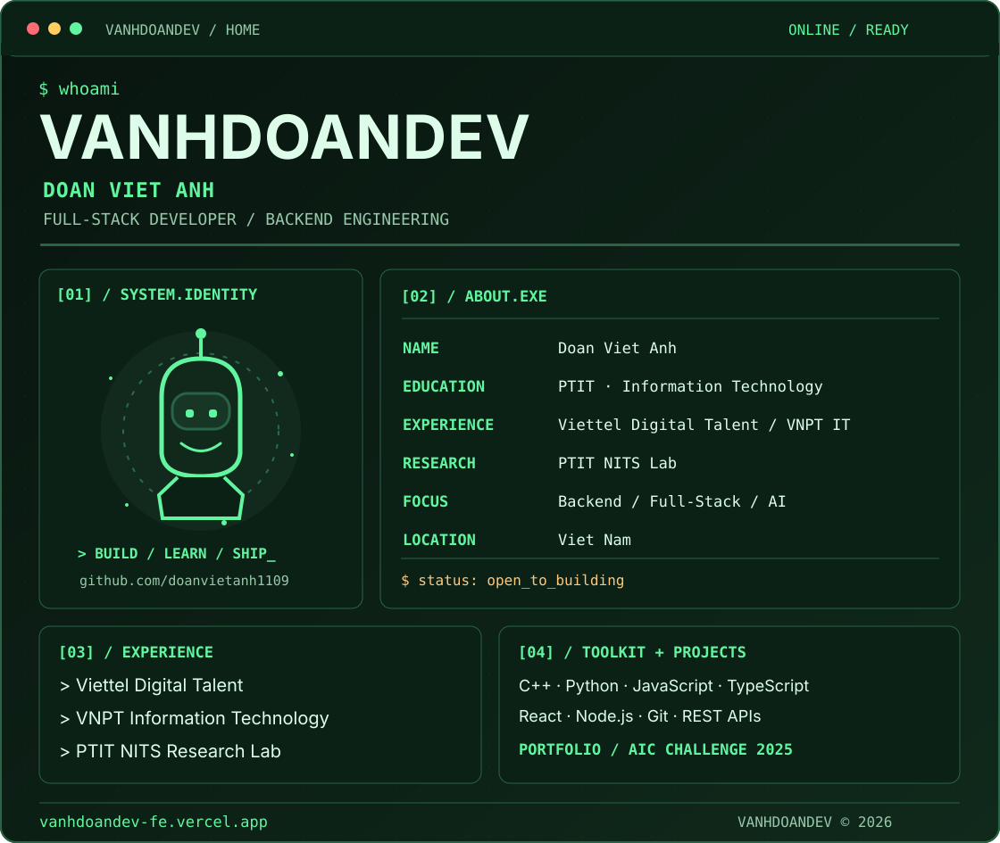
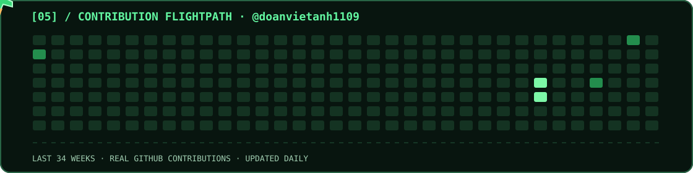
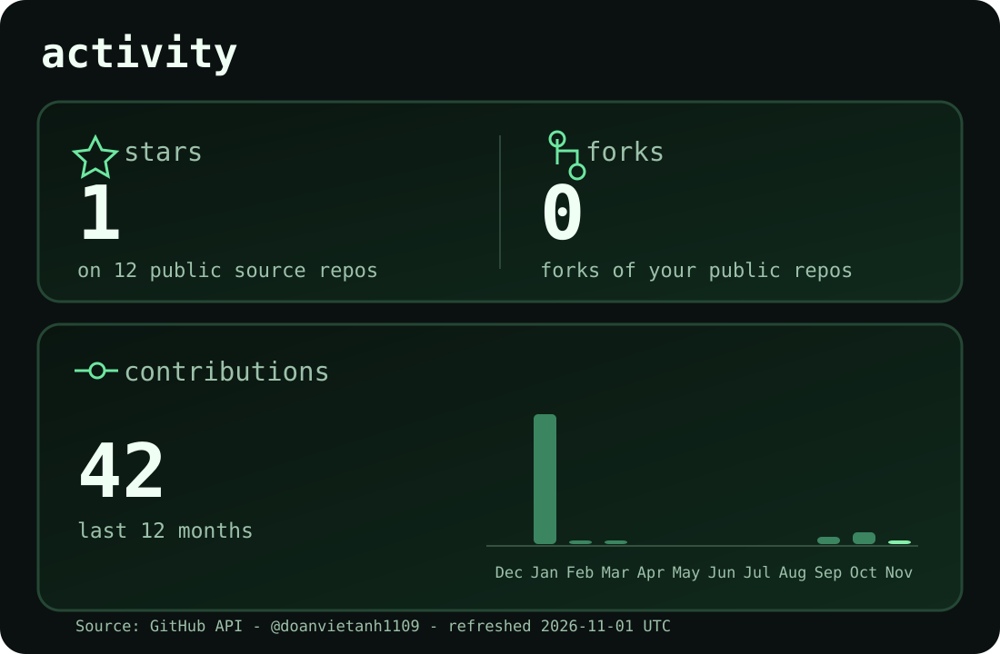

<!-- VANHDOANDEV GREEN PROFILE -->
<a href="https://vanhdoandev-fe.vercel.app/">
  <picture>
    <source
      media="(prefers-color-scheme: dark)"
      srcset="./dark.svg"
    />
    <source
      media="(prefers-color-scheme: light)"
      srcset="./light.svg"
    />
    
  </picture>
</a>

<!-- GREEN JET ANIMATION -->

<!-- PORTFOLIO LINKS -->

[**PORTFOLIO**](https://vanhdoandev-fe.vercel.app/) &nbsp;•&nbsp; [**SOURCE CODE**](https://github.com/doanvietanh1109/VANHDOANDEV_FE)

<!-- ====================================== -->
<!-- GREEN GITHUB ACTIVITY DASHBOARD        -->
<!-- ====================================== -->

<!-- ====================================== -->
<!-- GREEN CONTRIBUTION SNAKE ANIMATION     -->
<!-- ====================================== -->

<h2 align="center">🐍 My GitHub Contributions</h2>

  <picture>
    <source
      media="(prefers-color-scheme: dark)"
      srcset="https://raw.githubusercontent.com/doanvietanh1109/doanvietanh1109/main/dist/snake-green-dark.svg"
    />
    <source
      media="(prefers-color-scheme: light)"
      srcset="https://raw.githubusercontent.com/doanvietanh1109/doanvietanh1109/main/dist/snake-green-light.svg"
    />
    
  </picture>

