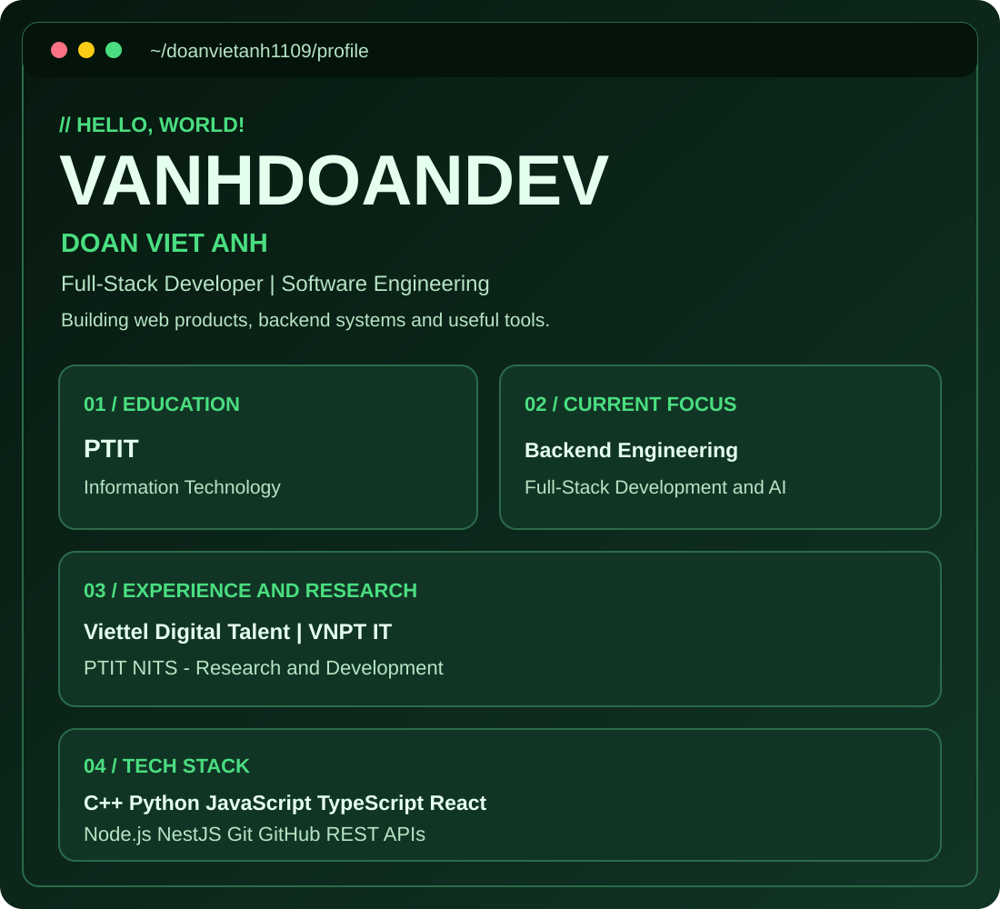

<a href="https://vanhdoandev-fe.vercel.app/">
<picture>
  <source media="(prefers-color-scheme: dark)" srcset="./assets/green-dark.svg">
  <source media="(prefers-color-scheme: light)" srcset="./assets/green-light.svg">
  
</picture>
</a>

### Full-Stack Developer | PTIT

## About Me

Hello! I'm **Doan Viet Anh**, an Information Technology student at PTIT.

I'm interested in Full-Stack Development, Backend Engineering, AI, and building real-world applications.

## Experience & Research

- Viettel Digital Talent
- VNPT Information Technology
- PTIT NITS Research Lab

## Tech Stack

**Languages:** C++, Python, JavaScript, TypeScript

**Frontend:** React, HTML, CSS

**Backend:** Node.js, NestJS, REST APIs

**Tools:** Git, GitHub, VS Code

## Featured Projects

### VANHDOANDEV Portfolio

My personal developer portfolio.

- [Live Website](https://vanhdoandev-fe.vercel.app/)
- [Source Code](https://github.com/doanvietanh1109/VANHDOANDEV_FE)

### AIC Challenge 2025

AI and problem-solving project experience.

## GitHub Activity

---

**VANHDOANDEV | Building. Learning. Improving.**

